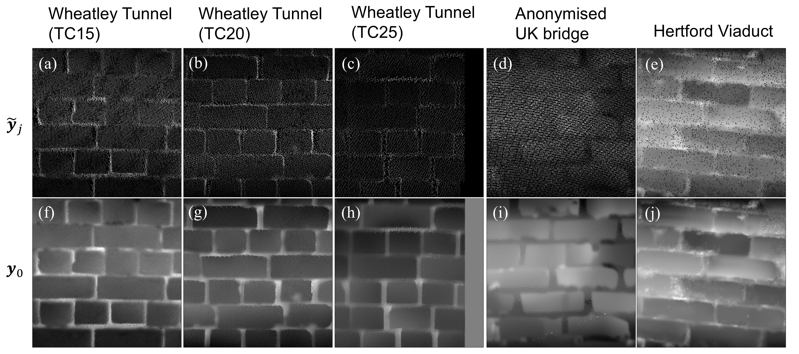
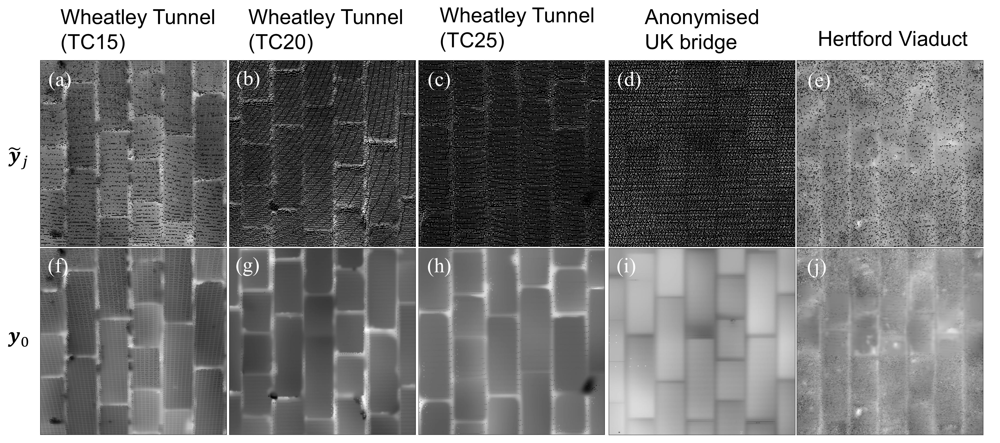
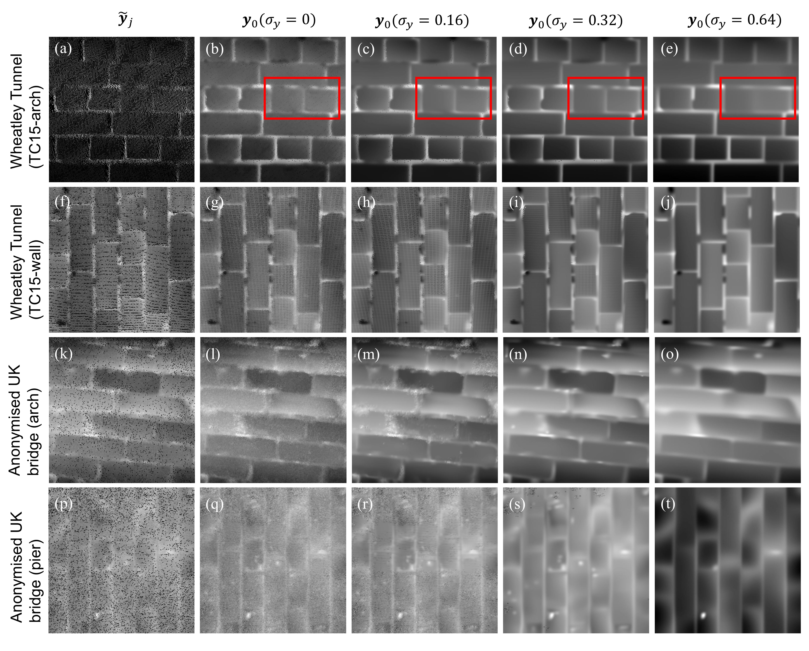
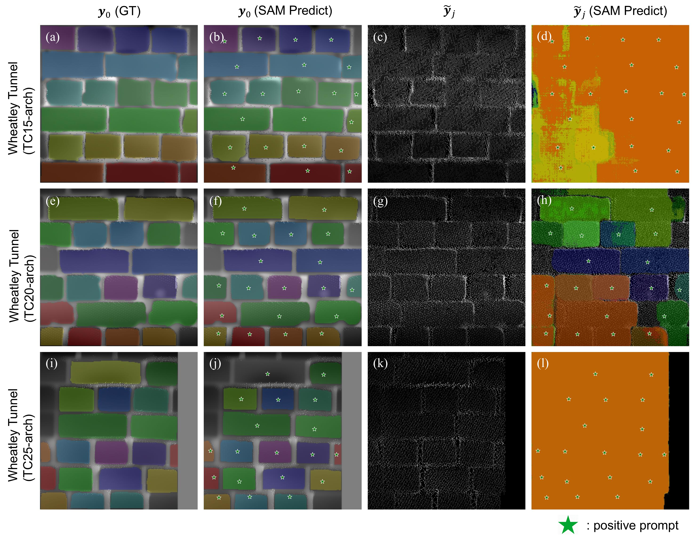
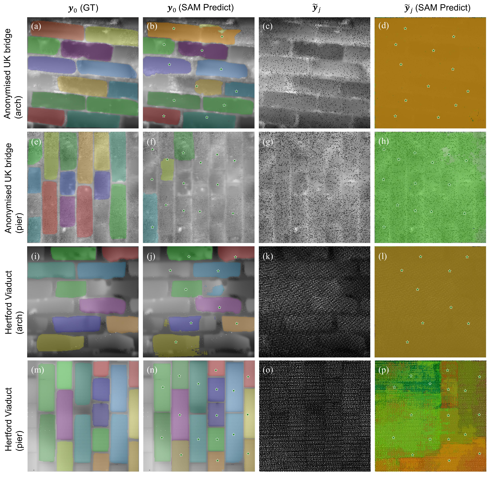

# InfraDiffusion: zero-shot depth map restoration with diffusion models and prompted segmentation from sparse infrastructure point clouds

Point clouds enable geometric monitoring for civil infrastructure, but fine-grained (brick-level) segmentation in low‑light environments (e.g., tunnels) is hampered by sparse, noisy depth data. InfraDiffusion projects 3D masonry point clouds into depth maps and restores them using an adapted Denoising Diffusion Null-space Model (DDNM). Without task‑specific training, the restored depth improves structure/texture fidelity and substantially boosts zero‑shot brick-level segmentation via the Segment Anything Model (SAM). Experiments on masonry bridge and tunnel datasets show consistent improvements, highlighting the potential for automated inspection of masonry assets.

## Authors
- [Yixiong Jing (University of Cambridge)](https://www.researchgate.net/profile/Yixiong_Jing2), 
Cheng Zhang (Hunan University), [Haibing Wu* (University of Cambridge)](https://scholar.google.com/citations?user=PrZX2hwAAAAJ&hl=en), [Guangming Wang (University of Cambridge)](https://scholar.google.com/citations?user=GGHfHSIAAAAJ&hl=zh-CN), [Olaf Wysocki (University of Cambridge)](https://scholar.google.com/citations?user=9xQhtFcAAAAJ&hl=en), [Brian Sheil (University of Cambridge)](https://scholar.google.com/citations?user=2bCP1igAAAAJ&hl=en)

---

## Setup

Recommended:
- Ubuntu: 20.04 or 22.04
- Python: 3.9
- CUDA Toolkit: 12.9
- PyTorch: 2.8.0

```bash
  conda create -n infradiffusion python=3.9
  pip3 install torch torchvision --index-url https://download.pytorch.org/whl/cu129
  pip3 install -r requirements.txt
```

---

## Datasets

We developed [**InfraDepth**](https://huggingface.co/datasets/jing222/InfraDepth) (can be downloaded from Hugging Face), a dataset of rendered depth map patches for **masonry bridges** and **tunnels**.  

It contains virtual-camera projections of 3D point clouds into fixed-size depth patches, with associated masks and camera parameters.  


---

## Pretrained Weights

- OpenAI Diffusion (UNet) Weight
[Required file (unconditional 256×256)](https://github.com/openai/guided-diffusiont):
```
exp/logs/imagenet/256x256_diffusion_uncond.pt
```

- [Segment Anything (SAM) Weights](https://github.com/facebookresearch/segment-anything). Place SAM weights under:
```
exp/logs/sam/
  sam_vit_b_01ec64.pth
  sam_vit_l_0b3195.pth
  sam_vit_h_4b8939.pth
```

---
## Pipeline Overview
1. Run InfraDiffusion restoration.  
2. Run `sam_eval.py` to produce SAM result archives.  
3. Run `sam_vis.py` to generate composite figures & mIoU summary.  
---

## Running InfraDiffusion 

- (1) Masonry Tunnel Dataset

```bash
python main.py data=tunnels \
    image_restore.deg=inpainting \
    image_restore.sigma_y=0.16 \
    general.save_results=true
```

- (2) Masonry Bridge Dataset
```bash
python main.py data=masonry_bridges \
    image_restore.deg=inpainting \
    image_restore.sigma_y=0.16 \
    general.save_results=true
```

- (3) Selecting a Specific Infrastructure (infrastructure names can be found in `configs/data`)

Example: To just get image restoration results on `hertfordshire`, override it:
```bash
python main.py \
    data=masonry_bridges \
    data.infra_name='begc' \
    image_restore.deg=inpainting \
    image_restore.sigma_y=0.16 \
    general.save_results=true
```

- (4) Adjusting Noise Level (σ_y)

`sigma_y` controls simulated observation noise.

```bash
python main.py data=tunnels image_restore.sigma_y=0.16
python main.py data=tunnels image_restore.sigma_y=0.32
```

---

## Generating & Visualizing SAM Segmentation Results

### Generate SAM Predictions(all masks)

This script loads the restored depth maps and runs SAM zero‑shot segmentation using centroid prompts (and optional negative prompts).

```bash
python sam_eval.py general.infra_group=tunnels sam.sam_model_type=vit_h
# With negative prompts(set general.use_negative_prompts=true)
python sam_eval.py general.infra_group=masonry_bridges general.use_negative_prompts=true
```

### Visualize SAM results(select existing patch index)
```bash
python sam_vis.py general.infra_group=tunnels general.patch_index=1115
```

Optional overrides in `general.patch_index`:
```bash
python sam_vis.py general.infra_group=masonry_bridges general.patch_index=42
```
---

## Results

### 1. Zero-shot IR results
Arch:



Pier:



Varied noise level `sigma_y`:



### 2. Zero-shot SAM results

Tunnels:



Masonry bridges:



## Citation
If you use this codebase, please cite (formal BibTeX forthcoming):
```
@article{jing2025infradiffusion,
  title={InfraDiffusion: zero-shot depth map restoration with diffusion models and prompted segmentation from sparse infrastructure point clouds},
  author={Jing, Yixiong and Zhang, Cheng and Wu, Haibing and Wang, Guangming and Wysocki, Olaf and Sheil, Brian},
  year={2025},
  note={Preprint}
}
```

---

## Acknowledgement
We used some code from [DDNM](https://github.com/wyhuai/DDNM) to make comparisons in our work. We would like to greatly thank them for their sharing.


